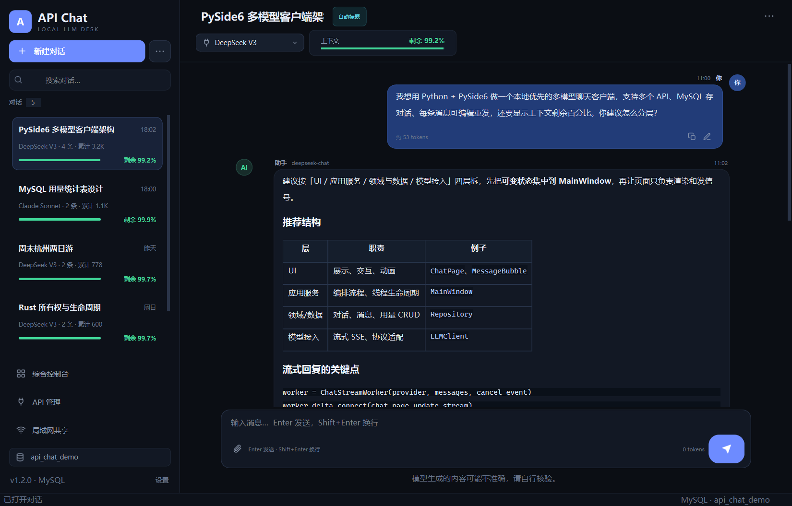
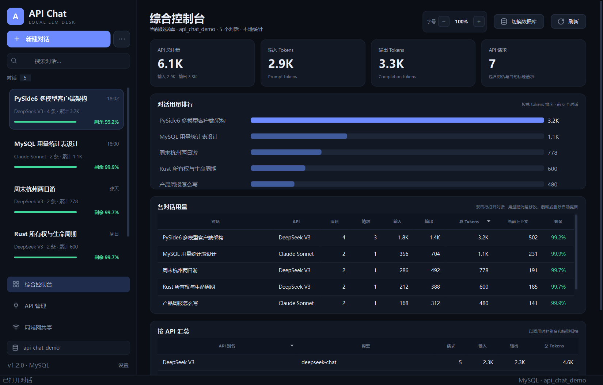
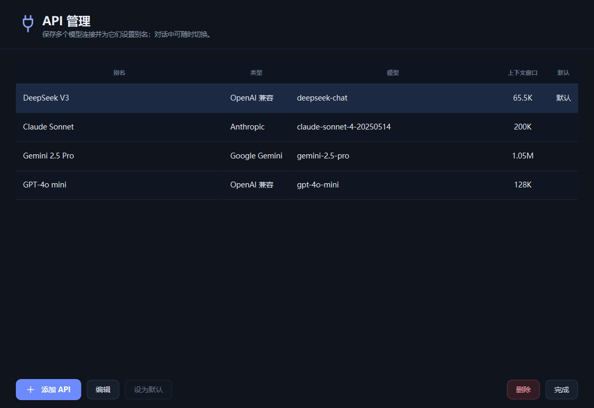
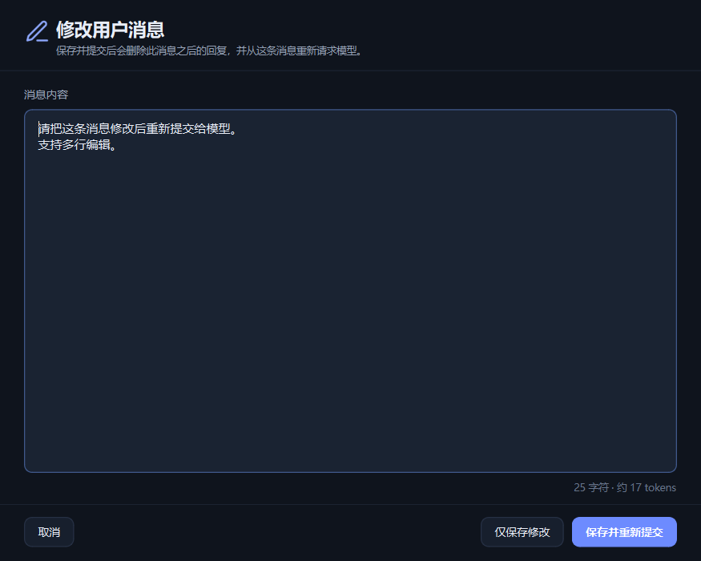
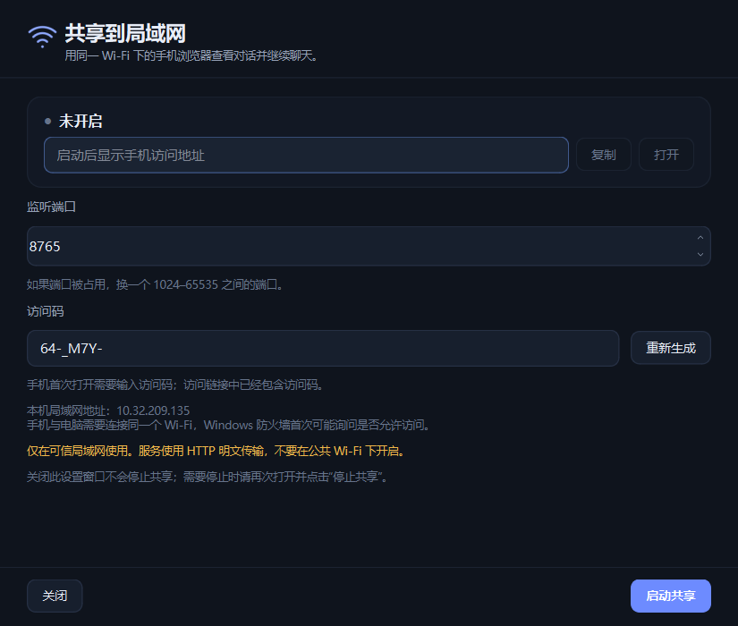
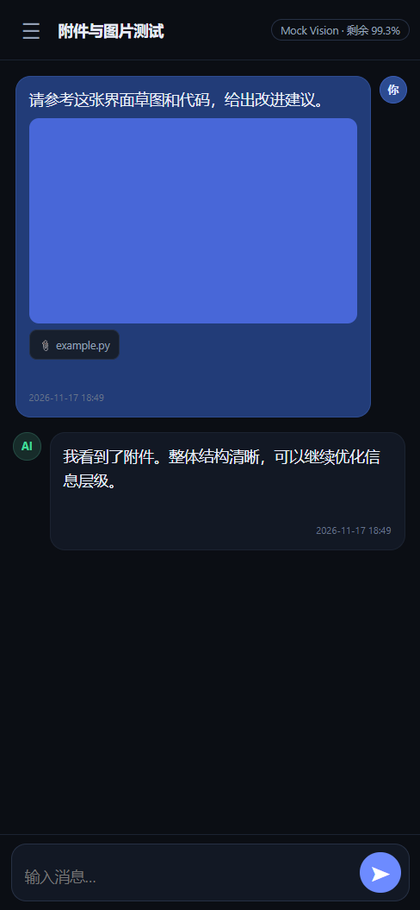

# API Chat

一个本地优先的 Win64 多模型聊天客户端。用 PySide6 构建界面，对话、API 配置、附件和用量统计保存在本地 MySQL；支持 OpenAI 兼容接口、Anthropic 和 Google Gemini，也可以把对话共享给局域网内的手机浏览器继续使用。





> 截图使用演示数据；`scripts/seed_demo.py` 可以生成同款本地演示数据库，不会写入 `api_chat`。

## 功能

- **多 API 管理**：每个 API 可设置别名、Base URL、模型、上下文窗口、最大输出、温度和系统提示词；对话内可随时切换 API。
- **MySQL 对话存储**：默认数据库 `api_chat`，首次运行自动建库建表；对话列表支持新建、搜索、重命名、删除和清空。
- **单条消息修改**：用户消息可「保存并重新提交」，自动删除该消息之后的旧回复并重新请求模型；助手消息可编辑保存到历史。
- **剩余上下文百分比**：对话列表和对话头部都显示剩余上下文，按消息 token 估算与模型窗口计算；低于阈值会变色提醒。
- **模型自动标题**：第一轮回复后由模型生成简短标题，可在标题栏直接改名，也可从菜单重新生成。
- **综合控制台**：总 Tokens、输入/输出 Tokens、请求数、对话用量排行、各对话明细、按 API 汇总；支持一键切换数据库。
- **本地用量联动**：消息被编辑、截断、删除或对话被清空/删除时，关联的用量事件会一起更新。
- **附件与图片**：支持图片（PNG/JPG/WebP/GIF/BMP）和文本/代码文件，可拖入、粘贴或选择文件；图片会随消息进入多模态请求，支持大图预览和附件保存。
- **网页对话导入**：从「新建对话」右侧的「…」进入，可读取公开的 ChatGPT / Claude / Gemini 分享链接、另存的 HTML，或粘贴带 User/Assistant 标记的文本。
- **文本导出**：任意本地对话可导出为 UTF-8 文本，包含标题、API、模型、时间和附件清单。
- **局域网共享**：启动带访问码的本地 HTTP 服务，手机连接同一 Wi-Fi 后即可查看对话、发送消息和查看附件；服务只共享当前 MySQL 数据库。
- **输入框与全局字号**：输入框随文本行数自动增高；综合控制台右上角可调整全局字号，也支持 `Ctrl+Shift++` / `Ctrl+Shift+-`，字号会保存到本地配置。
- **Windows 原生体验**：深色界面、流式输出、停止生成、错误重试、快捷键、HiDPI 支持和自定义应用图标。

## 快速开始

### 环境要求

- Windows 10/11 x64
- MySQL 8.x（默认 `127.0.0.1:3306`，用户 `root`，空密码）
- 已安装 Miniconda / Anaconda，且 `conda` 在 PATH 中

### 方式一：源码运行

1. 确认 MySQL 服务已启动：

   ```powershell
   Get-Service MySQL
   ```

2. 如果本机还没有 `apichat` conda 环境，双击 `setup_env.bat`，或手动执行：

   ```powershell
   conda create -n apichat python=3.11 -y
   conda activate apichat
   python -m pip install -r requirements.txt
   ```

3. 双击 `run.bat` 启动。调试时使用 `run_debug.bat`，可以看控制台日志。

首次启动会自动创建 `api_chat` 数据库和以下表：

```
api_providers  conversations  messages  attachments  usage_events  app_meta
```

如果 MySQL 连接失败，程序会弹出数据库设置窗口，可修改主机、端口、用户名、密码和数据库名。

### 方式二：打包版

```powershell
build_exe.bat
```

产物在 `dist\APIChat\APIChat.exe`。整个 `dist\APIChat` 文件夹需要一起复制，不能只拿走 exe。打包版同样需要本机 MySQL 服务。

## 配置 API

打开左侧「API 管理」→「添加 API」，至少填写：

| 字段 | 说明 |
|---|---|
| 别名 | 对话列表和顶部选择器中显示的名称，不能重复 |
| 提供商类型 | OpenAI 兼容 / Anthropic / Google Gemini |
| Base URL | 接口根地址，通常填到 `/v1` |
| 模型名称 | 服务商实际支持的模型 ID |
| API Key | 本地服务可留空；保存在本地 MySQL 中 |
| 上下文窗口 | 用于计算剩余上下文百分比 |
| 单次最大输出 | 每次请求的 `max_tokens` |
| 系统提示词 | 可选，会对该 API 的所有对话生效 |

常用配置示例：

| 服务 | 类型 | Base URL | 模型示例 |
|---|---|---|---|
| OpenAI | OpenAI 兼容 | `https://api.openai.com/v1` | `gpt-4o-mini` |
| DeepSeek | OpenAI 兼容 | `https://api.deepseek.com/v1` | `deepseek-chat` |
| OpenRouter | OpenAI 兼容 | `https://openrouter.ai/api/v1` | 以 OpenRouter 模型页为准 |
| Ollama | OpenAI 兼容 | `http://127.0.0.1:11434/v1` | `qwen2.5:7b` 等本地模型 |
| Anthropic | Anthropic | `https://api.anthropic.com/v1` | `claude-sonnet-4-20250514` |
| Google Gemini | Google Gemini | `https://generativelanguage.googleapis.com/v1beta` | `gemini-2.5-pro` |



编辑窗口里的「测试连接」会发送一个极短的请求验证地址、密钥和模型。模型 ID 会随服务商更新，请以实际账号可用列表为准。

## 使用

### 对话与 API

- 点击「新建对话」创建会话；每个对话独立绑定一个 API，顶部下拉框可随时切换。
- 对话列表显示：标题、API 别名、消息数、累计 Tokens、剩余上下文百分比。
- 右键对话卡片可重命名、自动生成标题、清空消息或删除。
- 搜索框按标题过滤对话。

### 上下文百分比

- 百分比 = `1 - 当前消息估算 tokens / 模型上下文窗口`。
- 对话头部的提示会显示已用/总窗口；顶部「自动标题」表示标题由模型生成。
- 估算按中英文混合文本计算，属于**近似值**；真实账单用量以 API 返回的 usage 为准，显示在综合控制台。

### 输入框与全局字号

- 输入框会从单行高度开始，随着 `Enter` 换行或文本自动换行逐行增高，最高约 150 px；清空后自动收回。
- 综合控制台右上角的「字号」控件可减小/增大全局字号，范围 80%–150%，每次 5%。
- 快捷键：`Ctrl+Shift++` 增大，`Ctrl+Shift+-` 减小；在输入框内也有效。
- 字号同时作用于侧栏、聊天气泡、Markdown、表格和控制台，并写入 `%APPDATA%\APIChat\config.json` 的 `font_scale`，下次启动自动恢复。

### 附件与图片

- 输入框左下角的回形针按钮可添加图片或文本/代码文件；也可以直接把文件拖入输入框，或从剪贴板粘贴图片。
- 每条消息最多 6 个附件；图片单张上限 10 MB，文本附件单张上限 2 MB。
- 图片会以缩略图显示在消息气泡中，点击可查看大图并保存原图；文本附件点击后可预览和保存。
- 图片会按所选 API 的协议转换为 OpenAI `image_url`、Anthropic `image` 或 Gemini `inline_data`；文本文件会作为带文件名标记的上下文发送。
- 只有支持视觉输入的模型才能理解图片；如果服务端报参数错误，请换用视觉模型或移除图片。
- 导入的网页图片会尽量下载并保存到本地附件表，最多 20 张。


### 导入网页分享对话

点击「新建对话」右侧的「…」→「导入网页分享对话…」，有三种来源：

1. **分享链接**：直接粘贴公开的 ChatGPT / Claude / Gemini 分享链接。
2. **HTML 文件**：在浏览器中打开分享页，按 Ctrl+S 另存为 HTML 后导入。适合需要登录或由 JavaScript 动态渲染的页面。
3. **粘贴文本**：使用 `User: …` / `Assistant: …`、`用户：…` / `助手：…` 等标记粘贴对话。

导入会创建一段新对话，角色、正文和可下载图片会重整为本地消息格式；标题设为手动标题，不会被自动生成覆盖。导入后可直接在当前 API 下继续聊天。


> 分享页结构会随平台更新；解析优先读取页面内嵌 JSON，再尝试常见 DOM 选择器和文本标记。若链接需要登录，请使用 HTML 文件或粘贴文本。

### 导出对话

在对话右上角「…」、左侧「…」菜单或对话卡片右键菜单中选择「导出为文本文件」。导出内容包含：

- 对话标题、API 别名、模型、创建时间和导出时间；
- 每条消息的角色、时间和完整文本；
- 附件类型、文件名、大小和图片尺寸。

文件使用 UTF-8 with BOM，Windows 记事本可直接打开。

### 修改消息并重新提交

- 用户消息右侧的铅笔按钮：可「仅保存修改」或「保存并重新提交」。
- 重新提交会删除该用户消息之后的所有消息，并从该消息重新请求模型。
- 助手消息也可编辑并保存；若要重新生成，建议编辑对应的用户消息后重新提交，避免历史中出现不自然的连续助手消息。
- 每次重新提交都会同步删除旧回复对应的用量事件，控制台会立即反映新的统计。



### 自动标题

- 第一轮模型回复完成后，如果标题仍是「新对话」且标记为自动，客户端会用同一 API 异步生成标题。
- 标题栏可直接点击修改；修改后「自动标题」标记消失，不再被自动覆盖。
- 菜单中的「重新生成标题」可强制再生成一次，标题请求的 tokens 也会计入控制台。

### 综合控制台

- 左侧「综合控制台」查看当前数据库的总用量和分对话用量。
- 顶部卡片：API 总用量、输入 Tokens、输出 Tokens、API 请求数。
- 中部：对话用量排行（前 6 个对话）；下方是按对话和按 API 的明细表。
- 双击对话行可回到该对话。
- 右上角「切换数据库」可选择本机 MySQL 中的其他数据库；数据库不存在时会自动创建表。默认仍是 `api_chat`。


### 局域网共享（手机 Web 页面）

左侧「局域网共享」打开设置：

- 设置监听端口和访问码，点击「启动共享」。
- 手机与电脑连接同一个 Wi-Fi，用手机浏览器打开窗口中显示的地址即可。
- 首次访问需要访问码；分享链接中已包含访问码。页面提供对话列表、消息查看、图片/文件附件、新建对话和继续聊天。
- 手机端发送消息会调用该对话绑定的 API，并将用户消息、助手回复和 usage 一起写入当前数据库；桌面端会同步刷新。
- 关闭设置窗口不会停止服务；需要停止时再次打开并点击「停止共享」。
- 电脑端关闭程序时会自动停止共享。
- Windows 防火墙首次可能询问是否允许 Python/APIChat 访问网络，请允许专用网络。





> 服务只监听局域网地址，不经过云端；访问码用于阻止同一局域网内的未授权访问。使用 HTTP 明文传输，请仅在可信 Wi-Fi 下开启。

## 数据与用量说明

- **对话数据**：`conversations`、`messages`。
- **附件**：`attachments`，保存原文件、缩略图、MIME、尺寸和 token 估算；删除消息/对话时级联清理。
- **API 配置**：`api_providers`（含 API Key、系统提示词）。
- **用量**：`usage_events`。`chat` 事件挂在具体助手消息上；`title` 事件没有 `message_id`，但仍属于该对话。
- 删除消息或截断历史时，通过外键级联删除对应 `chat` 事件；清空/删除对话会删除全部关联事件，因此控制台总量会同步减少。
- 控制台统计的是**当前数据库里仍然存在的对话用量**，不是服务商后台的历史账单。若需要保留历史账单，请不要删除对应对话，或另行导出。
- 标题生成属于额外 API 请求，也计入请求数、输入和输出 Tokens。
- 如果某个服务端不返回 usage，客户端会用文本估算补齐，并在消息底部标注为约值。

配置和日志位于：

```
%APPDATA%\APIChat\config.json    # 数据库连接、窗口位置、上次对话
%APPDATA%\APIChat\app.log        # 运行日志
```

## 项目结构

```
APIChat/
  app.py                     # 程序入口
  apichat/
    config.py                # JSON 配置
    db.py                    # MySQL 连接与建表
    repository.py            # 对话/消息/API/用量数据访问
    models.py                # 数据模型（含 Attachment）
    tokens.py                # token 估算、格式化
    llm.py                   # OpenAI / Anthropic / Gemini 适配、多模态与流式解析
    attachment_utils.py      # 图片/文本附件校验、缩略图
    importer.py              # 分享链接 / HTML / 文本解析
    exporter.py              # 文本导出
    lan_server.py            # 局域网 HTTP 服务与移动端页面
    workers.py               # QThread 工作线程
    ui/
      main_window.py         # 应用编排
      sidebar.py             # 对话列表、导入/导出/共享入口
      chat_page.py           # 对话页面、附件输入
      message_bubble.py      # 消息气泡、图片/文件展示
      attachment_preview.py  # 附件预览/保存
      dashboard_page.py      # 综合控制台
      api_dialog.py          # API 管理与编辑
      database_dialog.py     # 数据库设置
      edit_dialog.py         # 消息编辑
      import_dialog.py       # 网页对话导入
      share_dialog.py        # 局域网共享设置
      theme.py / icons.py    # 深色主题与矢量图标
  assets/                    # 应用图标与控件图标
  scripts/seed_demo.py       # 可选的演示数据（拒绝覆盖 api_chat）
  tests/                     # 数据库、协议、导入导出、LAN 测试
  APIChat.spec / build_exe.bat
```

## 开发与测试

```powershell
conda activate apichat
python -m unittest discover -s tests -v
```

- `tests/test_repository.py` 会创建临时 MySQL 数据库并在结束后删除，不会改动 `api_chat`；测试包含附件 token 和级联行为。
- `tests/test_llm.py` 启动本地假 HTTP 服务，测试 OpenAI SSE、Anthropic Messages、Gemini generateContent、多模态 payload 和错误信息，不需要真实 API Key。
- `tests/test_importer.py` 覆盖 ChatGPT JSON、Claude JSON、DOM、文本兜底、HTML 图片和导出格式。
- `tests/test_lan_server.py` 覆盖访问码、移动端页面、对话列表、附件下载、新建对话和手机端发送消息。
- 当前共 23 个测试。
- 可选的演示数据：

  ```powershell
  python scripts/seed_demo.py api_chat_demo
  ```

  该脚本会拒绝写入默认的 `api_chat` 数据库。

## 打包

```powershell
build_exe.bat
```

等价于：

```powershell
conda activate apichat
python -m pip install pyinstaller
pyinstaller --noconfirm --clean APIChat.spec
```

输出为单目录应用 `dist\APIChat`，其中 `APIChat.exe` 为入口。`assets` 会打包进 `_internal\assets`。

## 常见问题

**无法连接 MySQL / 服务未启动**

```powershell
Get-Service MySQL
Start-Service MySQL
mysql -u root -h 127.0.0.1
```

也可以在程序的「数据库设置」中改用其他主机、端口或账号。

**创建 conda 环境时连接失败**

若公司网络无法访问 conda 默认源，可先尝试：

```powershell
conda create -n apichat python=3.11 -y --offline
```

若本机缓存里没有 Python 3.11，可改用镜像源，或在已能联网的环境创建后迁移。

**401 / 403 / 404**

- 401：检查 API Key 是否有效。
- 403：检查账号额度、模型权限或地区限制。
- 404：检查 Base URL 是否少了 `/v1`，以及模型 ID 是否存在。
- 错误详情会显示在对话底部的错误条中，可点「重试」。

**流式回复不显示 / 网关不支持 `stream_options`**

客户端会自动对部分 400 错误做一次无 `stream_options` 的重试。如果服务商只支持非流式接口，请换用兼容 OpenAI Chat Completions 的地址，或使用支持 SSE 的网关。

**上下文百分比和账单不一致**

百分比是估算值，且不包含服务端的隐藏系统 token；账单以控制台的 API usage 为准。

## 安全说明

- API Key 以明文保存在本地 MySQL 的 `api_providers.api_key` 字段中；数据库密码以明文保存在 `%APPDATA%\APIChat\config.json`。请只在可信的本地电脑上使用，并妥善保护 MySQL 账号。
- 本程序不会上传对话到除所配置模型 API 之外的任何服务，也没有遥测。
- 局域网共享使用随机访问码校验，但传输层是 **HTTP 明文**。同一 Wi-Fi 下的其他设备或网络监听者可能看到内容，请只在可信网络中临时开启，用完即停止。
- 共享服务会暴露当前数据库中的全部对话；不要在包含敏感内容的数据库中长时间开启。
- 导入网页时，程序会访问用户填写的公开 URL；请只导入自己信任的链接。
- 如果多人共用电脑，建议为 MySQL 创建独立账号，并使用 Windows 文件权限保护配置目录。
